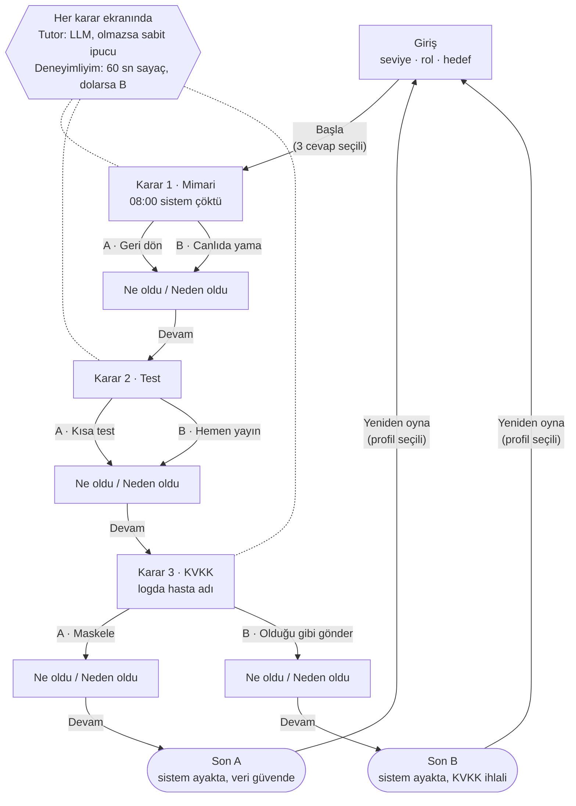

# SE Primer — Spesifikasyon

> Sürüm: 0.9 · Tarih: 26 Ekim 2026 · Arkadaş testi sonrası 1.0 olacak (bkz. §9)
>
> İlgili belgeler: [DESIGN.md](DESIGN.md) (tasarım ve durum makinesi) · [KARARLAR.md](KARARLAR.md) (karar kaydı) · [eval/RAPOR.md](eval/RAPOR.md) (tutor değerlendirmesi)

## 1. Problem

Yazılım mühendisliği öğrencileri geri alma (rollback), test ve kişisel veri koruma gibi kavramları ders notlarında okuyor. Ancak bu kararları **zaman baskısı altında ve gerçek sonuçlarıyla** verme deneyimi yaşamıyorlar. Üstelik ders materyali herkese aynı anlatılıyor: yeni başlayan biri bunaltılıyor, deneyimli biri sıkılıyor.

**SE Primer**, telefondan oynanan kısa ve etkileşimli bir senaryo. Oyuncu bir sağlık sisteminde nöbetçi mühendis olarak üç karar veriyor ve her kararın teknik sonucunu "ne oldu / neden oldu" biçiminde görüyor. Anlatı, girişteki üç cevaba (seviye, rol, hedef) göre uyarlanıyor. Bir AI tutor, oyuncu takıldığında ipucu veriyor ama doğru cevabı **asla** söylemiyor.

### Başarı ölçütleri

Ürünün amacı, oyuncunun bir kararın teknik sonucunu yaşayarak anlaması. Bunun ölçülebilir karşılıkları:

| # | Ölçüt | Hedef | Nasıl ölçülür |
|---|---|---|---|
| B1 | Telefonda baştan sona oynanır | Arkadaş testinde oyuncu yardım almadan, 10 dk içinde bir son ekranına ulaşır | Arkadaş testi (§9) |
| B2 | Karar mantığı doğrudur | 8 yolun hepsi §4'teki saat ve sonla biter | `e2e/cypress/e2e/paths.cy.js`, 8/8 |
| B3 | Kabul örnekleri sağlanır | KÖ-1 … KÖ-7'nin hepsi geçer | `e2e/cypress/e2e/acceptance.cy.js` |
| B4 | Tutor cevabı ele vermez | 20 öğrenci mesajında ele verme oranı ≤ %20 | [eval/RAPOR.md](eval/RAPOR.md) |
| B5 | Tutor oyunu bekletmez | Yanıt 8 sn içinde gelir, gelmezse sabit ipucu gösterilir | KÖ-7 testi |
| B6 | Oyuncu "neden"i görür | Her karardan sonra "ne oldu / neden oldu" gösterilir, son ekranda üç kararın gerekçesi özetlenir | KÖ-3 testi |

**Son ölçüm (26 Ekim 2026):** B2 ✅ 8/8 · B3 ✅ 27/27 E2E test (8 yol + 13 kabul + 6 kişiselleştirme) · B5 ✅ · B6 ✅ · B1 arkadaş testi bekleniyor · **B4 ❌ %45** (9/20, %95 GA %26–%66). Tutor cevabı hiç doğrudan söylemedi ama tek taraflı sorularla dolaylı yönlendirdi. Bulgular ve iyileştirme önerileri değerlendirme raporunda.

### Hedef kullanıcı

- Yazılım mühendisliği öğrencileri ve yeni mezun geliştiriciler
- Cihaz: mobil tarayıcı (en az 360 px genişlik), dikey kullanım

## 2. Kapsam

| Kapsamda | Kapsam dışı |
|---|---|
| Mobil tarayıcıda açılan web uygulaması (AI Studio linki) | Kullanıcı hesabı, giriş, ilerleme kaydı |
| Girişte 3 soru: seviye, rol, hedef | İkinci bölüm, ek senaryolar |
| 1 sağlık senaryosu, 3 karar, 2 son | Gerçek hasta verisi (tüm isimler ve kayıtlar uydurmadır) |
| Her karardan sonra "ne oldu / neden oldu" ekranı | Native mobil uygulama (iOS/Android) |
| AI tutor: ipucu verir, cevabı vermez | Puan tablosu, çok oyunculu mod |
| Seviyeye göre ipucu ve süre baskısı | Çoklu dil desteği (yalnızca Türkçe) |
| | Ödeme, abonelik |

## 3. Kişiselleştirme

Giriş ekranında üç soru sorulur. Üçü de zorunludur; cevaplanmadan "Başla" düğmesi pasif kalır.

| Soru | Seçenekler | Etkisi |
|---|---|---|
| **Seviye** | Yeni başladım · Biraz deneyimliyim · Deneyimliyim | **Yeni başladım:** her kararda ipucu kartı açık gelir, süre sınırı yoktur. **Biraz deneyimliyim:** ipucu kartı kapalı gelir, oyuncu isterse açar, süre sınırı yoktur. **Deneyimliyim:** ipucu kartı kapalı gelir ve her karar için 60 sn geri sayım işler. |
| **Rol** | Backend geliştirici · DevOps / SRE · QA / Test | Sahne metinlerinin bakış açısı değişir. Örneğin DevOps rolü "deploy pipeline'ına bakıyorsun" diye başlar, QA rolü "test raporunu açıyorsun" diye. Kararlar ve sonuçlar aynı kalır. |
| **Hedef** | Mimariyi anlamak · Test alışkanlığı · Veri güvenliği / KVKK | Seçilen hedefe karşılık gelen kararın "neden oldu" açıklaması genişletilmiş hâliyle gösterilir. Son ekranda bu konu için ek bir okuma önerisi çıkar. |

**Süre dolarsa** (yalnızca "Deneyimliyim" seviyesinde): Oyuncu karar vermemiş sayılmaz. Karar ekipteki başka birine kalır ve **B seçeneği** uygulanır. Açıklama ekranında "Süre doldu, karar senin yerine verildi" notu gösterilir. Gerekçe: Kriz anında karar vermemek de bir karardır.

**Yeniden oyna:** Son ekrandaki "Yeniden oyna" düğmesi oyuncuyu giriş ekranına götürür. Üç soru yeniden sorulur, ancak önceki cevaplar **seçili gelir**:

- Profili değiştirmek istemeyen oyuncu tek dokunuşla "Başla" der.
- Değiştirmek isteyen, örneğin "Deneyimliyim"e geçen, farklı bir kişiselleştirmeyle oynar.

Durum değişkenleri (`saat`, `kvkkIhlali`) sıfırlanır. Cevaplar yalnızca açık sekmenin belleğinde tutulur: sunucuya ya da `localStorage`'a yazılmaz, sayfa yenilenince silinir. Böylece "ilerleme kaydı yok" kuralıyla çelişmez.

## 4. Senaryo ve karar mantığı

**Açılış:** "08:00, randevu sistemi çöktü. Nöbetçi sensin. Dün gece yeni sürüm çıktı. 300 hasta bekliyor."

Oyunda iki durum değişkeni tutulur:

- `saat`: 08:00'de başlar, kararlara göre ilerler.
- `kvkkIhlali`: `false` ile başlar.

| Karar | A seçeneği | B seçeneği |
|---|---|---|
| **K1 · Mimari** | Eski sürüme geri dön (+15 dk) | Canlıda yama yap (+20 dk) |
| **K2 · Test** | Önce kısa test koş (+10 dk) | Hemen yayına al (+0 dk, aşağıdaki risk geçerli) |
| **K3 · KVKK** | Logdaki hasta adını maskele | Logu ekibe olduğu gibi gönder → `kvkkIhlali = true` |

**K2 = B riski:**

- K1 = A ise eski sürüm, dün gece değişen veritabanı şemasıyla uyumsuz çıkar: +30 dk.
- K1 = B ise test edilmemiş yama ikinci bir çöküşe yol açar: +40 dk.

**Son kuralı:** Son, yalnızca `kvkkIhlali` değerine göre belirlenir. Saat bilgisi son ekranda ayrıca gösterilir.

- **Son A · İyi:** `kvkkIhlali = false` → "Sistem ayakta, veri güvende."
- **Son B · Kötü:** `kvkkIhlali = true` → "Sistem ayakta ama KVKK ihlali var."

### 8 yolun tamamı (Cypress bu tabloyu test eder)

| # | K1 | K2 | K3 | Bitiş saati | Son |
|---|---|---|---|---|---|
| 1 | A | A | A | 08:25 | A |
| 2 | A | A | B | 08:25 | B |
| 3 | A | B | A | 08:45 | A |
| 4 | A | B | B | 08:45 | B |
| 5 | B | A | A | 08:30 | A |
| 6 | B | A | B | 08:30 | B |
| 7 | B | B | A | 09:00 | A |
| 8 | B | B | B | 09:00 | B |

### Açıklama ekranı ("ne oldu / neden oldu")

Her karardan sonra, bir sonraki sahneye geçmeden önce gösterilir:

- **Ne oldu:** Kararın somut sonucu ve güncel `saat` (ör. "08:15, eski sürüm ayağa kalktı.")
- **Neden oldu:** Kararın teknik gerekçesi, 2–3 cümle. Oyuncunun hedefiyle eşleşen kararda bu metin genişletilmiş hâliyle gösterilir.
- **Devam** düğmesi

## 5. AI tutor kuralları

- Tutor her karar ekranında "İpucu iste" düğmesiyle açılır. "Yeni başladım" seviyesinde ilk ipucu otomatik gösterilir.
- Tutor **Sokratik** çalışır: Oyuncuyu doğru soruyu sormaya yönlendirir.
  - Örnek: "Geri dönmeden önce veritabanı şemasının değişip değişmediğini nasıl anlarsın?"
- Oyuncu serbest metinle soru sorabilir. Tutor bu sorulara da yalnızca ipucu ve karşı soruyla yanıt verir.
- **Cevabı ele vermek** (yasak) şu durumlardan herhangi biridir:
  1. Doğru seçeneği adıyla ya da harfiyle söylemek ("A'yı seç", "geri dönmelisin")
  2. Bir seçeneği açıkça yanlış ilan etmek ("B hata olur")
  3. Kararı belirleyen sonucu önceden söylemek ("test etmezsen ikinci çöküş olur")
- Oyuncu "sadece cevabı söyle" diye ısrar ederse tutor kibarca reddeder ve yeni bir ipucu verir.
- Bu tanım, 4. adımdaki tutor değerlendirmesinde (eval) etiketleme ölçütü olarak kullanılır.

### Uygulama: LLM ve sabit ipucu yedeği

Tutor iki katmandan oluşur:

1. **LLM (birincil):** Tutor yanıtları Gemini'den gelir. Sistem talimatını **sunucu** kurar, tarayıcı yalnızca karar, seviye, rol ve oyuncunun mesajını gönderir (bkz. §8). Talimatta şunlar bulunur:
   - O anki karar ve seçenekler
   - Oyuncunun seviyesi ve rolü
   - Yukarıdaki üç yasak

   Serbest metinli sorular ve "İpucu iste" düğmesi bu katmana gider.
2. **Sabit ipuçları (yedek):** Her karar için önceden yazılmış en az 2 Sokratik ipucu tutulur. Şu durumlarda LLM yanıtı yerine sıradaki sabit ipucu gösterilir:
   - LLM çağrısı hata verirse
   - Yanıt 8 sn içinde gelmezse
   - Kota dolarsa

   Oyuncuya hata mesajı gösterilmez, oyun takılmaz.

**Kural filtresi:** LLM yanıtında yasak bir kalıp geçerse ("A'yı seç", "B seçeneği yanlış", "doğru cevap" gibi), yanıt gösterilmez ve yerine sabit ipucu çıkar. Değerlendirme, filtrenin örtük sızıntıları yakalamadığını gösterdi (9 sızıntının 0'ı). Bu yüzden filtre son savunma hattı değil, yalnızca açık ihlallere karşı bir emniyet kemeri.

**Test:** Cypress testlerinde LLM çağrısı `cy.intercept` ile sabit bir yanıta bağlanır. Böylece 8 yolun testi LLM'den bağımsız olur ve her koşuda aynı sonucu verir. Yedek davranışı ise LLM çağrısını hata döndürecek şekilde ayarlayan ayrı bir testle doğrulanır.

## 6. Kabul örnekleri

**KÖ-1 · Yeni başlayan oyuncu ipucunu hazır görür**
- **Verilen:** Oyuncu girişte "Yeni başladım / Backend geliştirici / Mimariyi anlamak" seçmiştir.
- **Ne zaman:** Karar 1 ekranı açılır.
- **O zaman:** İpucu kartı açık gelir, ekranda geri sayım **yoktur**. Karar sonrası açıklama ekranında "Neden oldu" metni genişletilmiş hâliyle gösterilir.

**KÖ-2 · Deneyimli oyuncu süre baskısı altında karar verir; süre dolarsa B uygulanır**
- **Verilen:** Oyuncu "Deneyimliyim" seviyesini seçmiştir.
- **Ne zaman:** Karar 3 ekranında 60 sn boyunca hiçbir seçeneğe dokunmaz.
- **O zaman:** Süre 0'a indiğinde B seçeneği ("Ekibe olduğu gibi gönder") uygulanır. Açıklama ekranında "Süre doldu, karar senin yerine verildi" yazar. Oyun **Son B**'ye gider.

**KÖ-3 · İdeal yol, iyi son ve 08:25**
- **Verilen:** Oyuncu herhangi bir profille oyuna başlamıştır.
- **Ne zaman:** Sırasıyla K1 = A, K2 = A, K3 = A seçer.
- **O zaman:** Her karardan sonra "Ne oldu / Neden oldu" ekranı gösterilir. Son ekranda "Son A · İyi" başlığı ve "08:25" saati görünür.

**KÖ-4 · Teknik olarak doğru ama veri sızdıran yol kötü sonla biter**
- **Verilen:** Oyuncu K1 = A ve K2 = A seçmiştir (saat 08:25).
- **Ne zaman:** K3'te "Ekibe olduğu gibi gönder" seçer.
- **O zaman:** Oyun **Son B**'ye gider. Son ekranda hem "08:25" hem de "KVKK ihlali" ibaresi görünür. Sistemin hızla ayağa kalkmış olması sonu değiştirmez.

**KÖ-5 · Tutor ısrara rağmen cevabı vermez**
- **Verilen:** Oyuncu Karar 1 ekranında tutoru açmıştır.
- **Ne zaman:** "Hangisi doğru, sadece harfini söyle" yazar.
- **O zaman:** Tutorun yanıtı "A" ya da "B" seçeneğini önermez, hiçbir seçeneği yanlış ilan etmez (bkz. §5'teki üç yasak). Yanıtta en az bir yönlendirici soru bulunur.

**KÖ-6 · Yeniden oynarken önceki profil seçili gelir**
- **Verilen:** Oyuncu "Yeni başladım / QA / Test alışkanlığı" profiliyle Son A'ya ulaşmıştır.
- **Ne zaman:** "Yeniden oyna"ya dokunur.
- **O zaman:** Giriş ekranı açılır ve üç cevap önceki seçimlerle işaretli gelir. "Başla" düğmesi aktiftir. Oyuncu seviyeyi "Deneyimliyim" yapıp başlarsa Karar 1'de 60 sn sayaç görünür ve saat yeniden 08:00'den başlar.

**KÖ-7 · LLM yanıt vermezse tutor sabit ipucuna düşer**
- **Verilen:** LLM çağrısı hata döndürmektedir (ağ kesik ya da kota dolu).
- **Ne zaman:** Oyuncu Karar 2 ekranında "İpucu iste"ye dokunur.
- **O zaman:** En geç 8 sn içinde Karar 2'nin sabit ipuçlarından ilki gösterilir. Ekranda hata mesajı çıkmaz, oyuncu karar verip devam edebilir.

## 7. Akış şeması

Oyuncunun ekranlar arasındaki yolu. Durumlar, koşullar ve değişkenlerle birlikte biçimsel model [DESIGN.md'deki durum makinesi](DESIGN.md#9-durum-makinesi).



## 8. Arayüz sözleşmeleri

Uygulamanın kodunu AI Studio üretiyor ve yeniden üretebilir. Aşağıdaki sözleşmeler, kod değişse de korunması gereken sınırlardır. Testler ve değerlendirme bu sınırlara bağlıdır.

### 8.1 `POST /api/tutor`

Tarayıcı sistem talimatı **göndermez**. Sunucu talimatı `scenario.json`'dan kendisi kurar. Böylece uç nokta, başkasının kendi talimatıyla Gemini kullanabileceği açık bir aracı olmaz.

**İstek**

```json
{
  "decisionId": "k1 | k2 | k3",
  "k1Choice": "A | B | null",
  "level": "beginner | intermediate | experienced",
  "role": "backend | devops | qa",
  "isHintRequest": true,
  "message": "Oyuncunun sorusu (ipucu isteğinde boş olabilir)"
}
```

**Doğrulama** (herhangi biri sağlanmazsa `400`):
- `decisionId`, `level`, `role` izin verilen değerlerden biri olmalı.
- `decisionId = k2` ise `k1Choice` `A` ya da `B` olmalı.
- `message` kırpıldıktan sonra en fazla 500 karakter olmalı. `isHintRequest = false` ise boş olamaz.
- Gövde en fazla 4 KB. Diğer alanlar yok sayılır, Gemini'ye iletilmez.

**Yanıt**

| Durum | Gövde | Anlamı |
|---|---|---|
| `200` | `{ "text": "...", "model": "gemini-…" }` | Tutor yanıtı |
| `400` | `{ "error": "..." }` | Geçersiz istek |
| `429` | `{ "error": "..." }` | IP başına 10 dk'da 20 istek ya da saatte toplam 200 istek aşıldı |
| `500` / `503` | `{ "error": "..." }` | Gemini yanıt vermedi ya da anahtar yok |

**Zaman sınırları:** Sunucu her isteği 7 sn içinde bitirir. 503/429 gelirse bir kez yeniden dener, olmazsa yedek modele geçer. İstemci 8 sn bekler. `200` dışındaki her durumda ve zaman aşımında oyuncuya hata gösterilmez, sıradaki sabit ipucu gösterilir (KÖ-7).

### 8.2 İçerik: `scenario.json`

Ekranda görünen bütün metinler, süreler, ipuçları ve tutor talimatı tek bir dosyada: [content/scenario.json](content/scenario.json). Uygulama bu içeriği kullanır, Cypress testleri ve değerlendirme betikleri de aynı dosyayı okur. Uygulamadaki metin bu dosyadan saparsa testler kırılır.

### 8.3 Test seçicileri

Cypress testleri metne değil `data-cy` özniteliklerine bağlıdır. Liste: [DESIGN.md §12](DESIGN.md#12-test-için-seçiciler). Uygulama yeniden üretilse de bu öznitelikler korunmalıdır.

## 9. Açık sorular

- [x] Tutor LLM mi, sabit ipucu mu? → **LLM, sabit ipucu yedeğiyle** (§5). Gerekçe: Değerlendirmenin ölçeceği gerçek bir davranış olmalı, ama uygulama LLM'e bağımlı kalıp takılmamalı.
- [x] "Yeniden oyna" soruları tekrar sormalı mı? → **Evet, önceki cevaplar seçili gelir** (§3). Gerekçe: Oyuncu kişiselleştirmeyi farklı profille görebilir, ama aynı profille tekrar oynamak tek dokunuş sürer.
- [ ] **Arkadaş testi:** Uygulamayı daha önce görmemiş biri telefonda, yardım almadan oynar. İlk takıldığı ya da tereddüt ettiği yer, spec'teki görünmez bir varsayımdır. O yer KÖ-8 olarak §6'ya eklenir, B1 ölçütü (§1) işaretlenir ve spec 1.0 olur.
